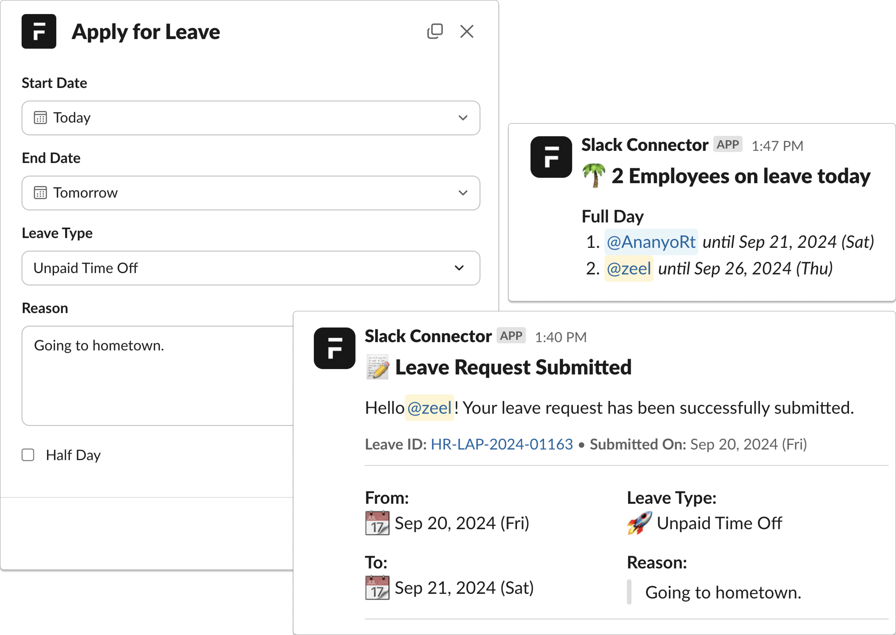

<div align="center">

<h2>Frappe Slack Connector</h2>
   Frappe app that integrates the Leave Management module with Slack.
</div>
<br>
<div align="center">

</div>

## Key Features

- **Apply for Leave**: Use a custom Slack command to apply for leave. For example:
   ```
   /apply-leave
   ```
   This will open up a modal that you can use to submit your leave details.

- **Leave Approval/ Rejection**: Leave approvers will receive a Slack notification with options to either Approve or Reject the leave directly from Slack.

- **Daily Leave Reminders**: Every working day at the specified time, a Slack message will list all employees currently on leave.

## Prerequisite

Before you begin, make sure you have following apps installed on your site:

- [ERPNext](https://github.com/frappe/erpnext)
- [Frappe HR](https://github.com/frappe/hrms)

## Installation

Run the following command to install the app.

```bash
bench get-app https://github.com/rtCamp/frappe-slack-connector
bench --site [site-name] install-app frappe_slack_connector
bench --site [site-name] migrate
bench restart
```

For local development, check out our dev-tool for seamlessly building Frappe apps: [frappe-manager](https://github.com/rtCamp/Frappe-Manager)  
NOTE: If using `frappe-manager`, you might require to `fm restart` to provision the worker queues.

## Slack Setup
Visit the detailed [Slack setup guide](https://github.com/rtCamp/frappe-slack-connector/wiki/Getting-Started) on wiki.

## Health check

`GET /api/method/frappe_slack_connector.api.health.slack_endpoints` loads every method Slack calls (interactions, `/apply-leave`, `/timesheet`) and every function the app registers as a document or scheduler hook, and answers HTTP 200 with `{"message": {"ok": true}}`, or HTTP 503 with `{"message": {"ok": false, "failed": [...]}}` naming the entry points that no longer load. Point an uptime monitor at it (GET or HEAD, expect 200) and hit it right after every deploy or `bench restart` (a `bench migrate` alone does not reload the running workers): Frappe imports a handler on its first request, so a dependency that moved underneath one (an upstream app renaming a helper, for example) otherwise only shows up as HTTP 417 on the live Slack endpoints, with nothing in Error Log.

The unit-tests workflow also runs weekly (and on a manual *Run workflow*) against the current upstream `version-16` branches of Frappe, ERPNext and HRMS on both `develop` and `version-16`; set the `SLACK_ALERT_WEBHOOK_URL` repository secret to have a scheduled failure posted to Slack. GitHub disables scheduled workflows after 60 days without repository activity, so check the workflow is still enabled after a quiet spell. The `version-16` leg only runs these checks once they are released into `version-16`.

## Documentation

Please refer to our [Wiki](https://github.com/rtCamp/frappe-slack-connector/wiki) for details.

## Contribution Guide

Please read [CONTRIBUTING.md](./CONTRIBUTING.md) for details.

## License

This project is licensed under the [AGPLv3 License](./LICENSE).
